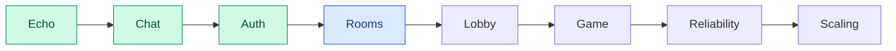
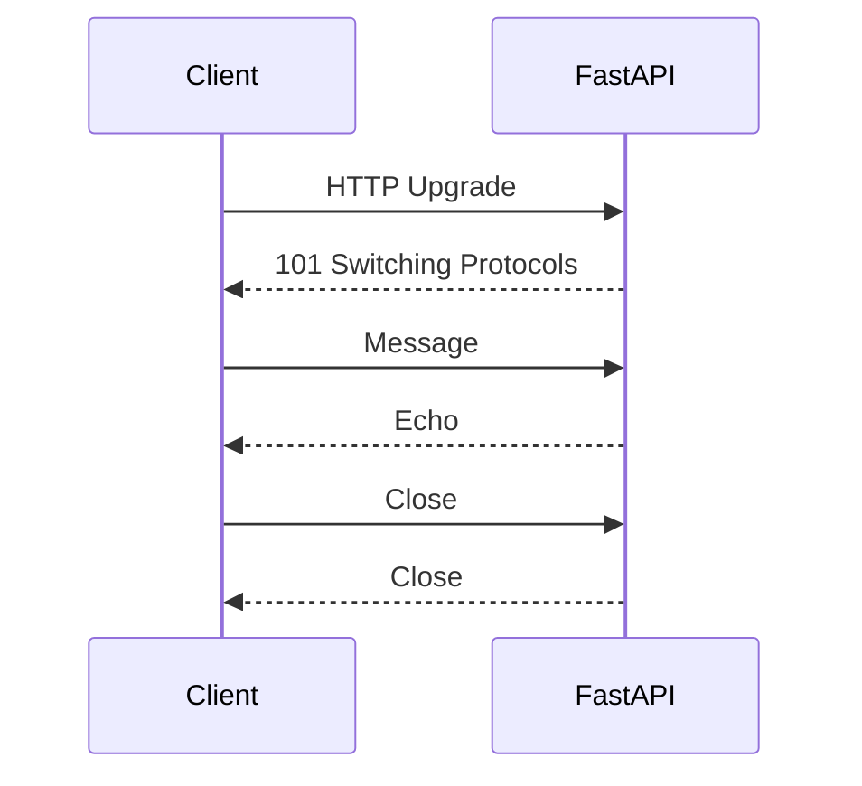
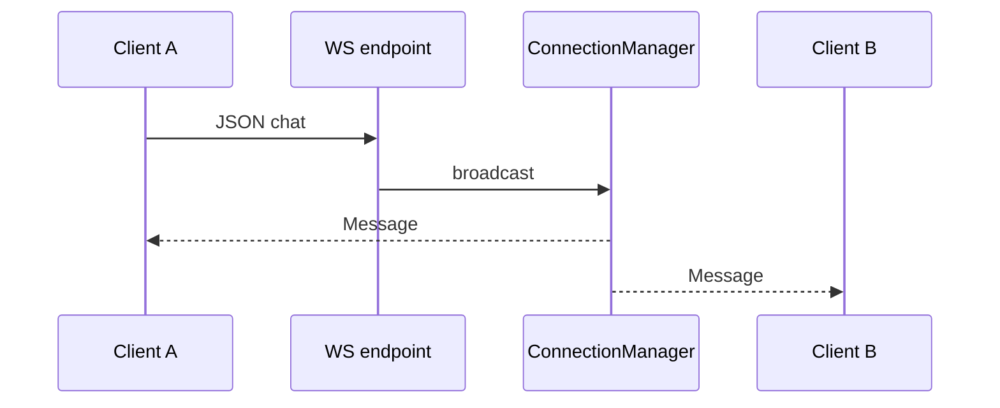
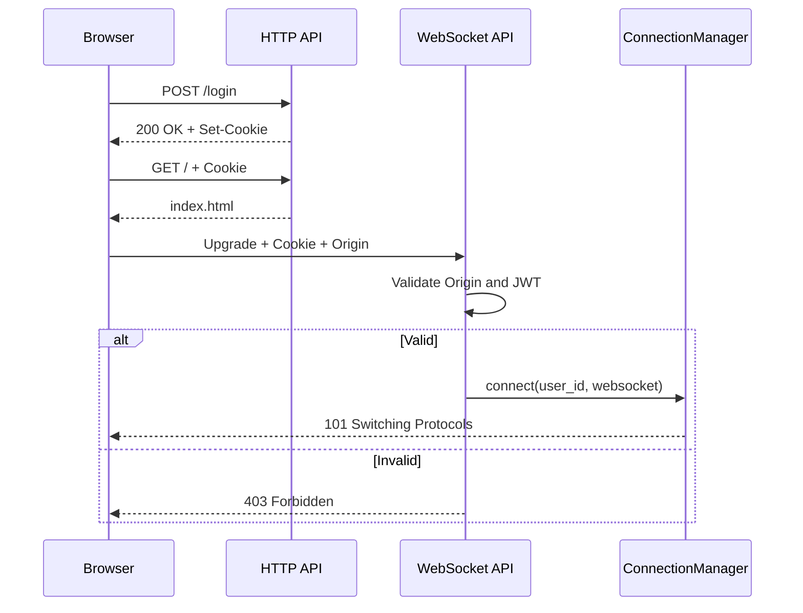
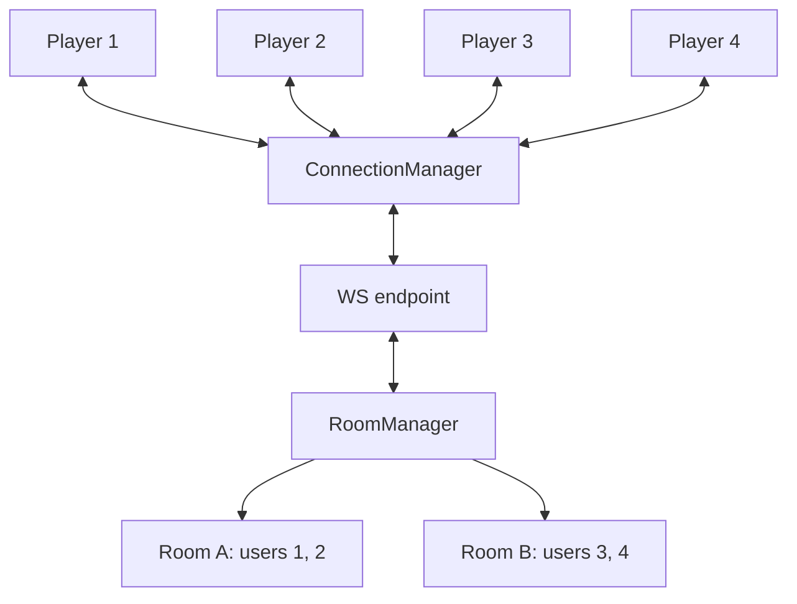
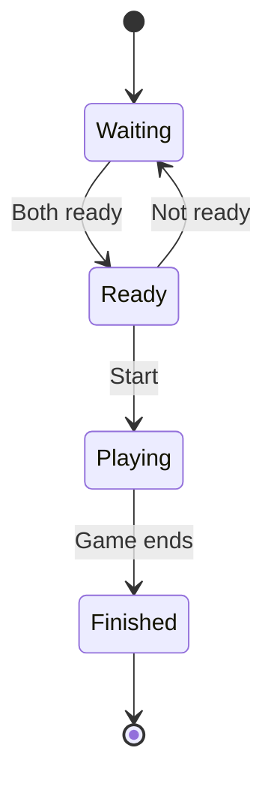
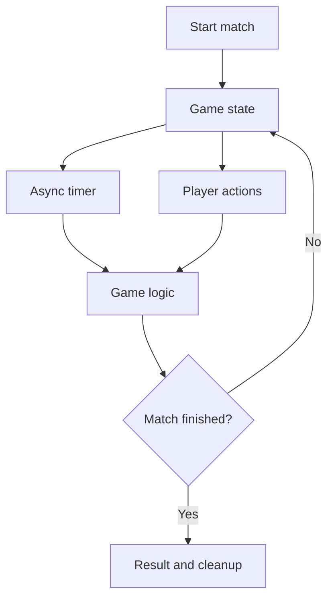
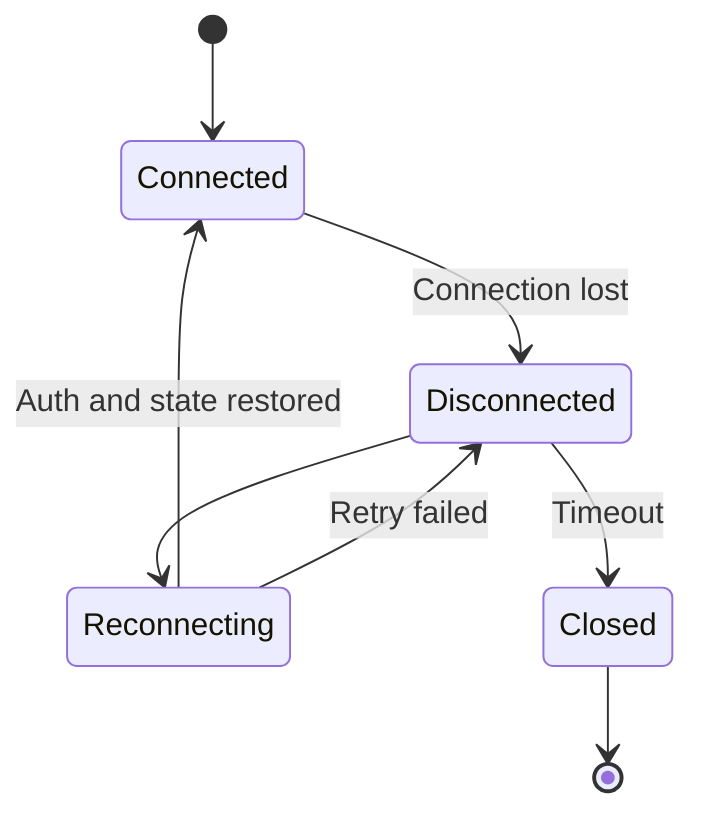
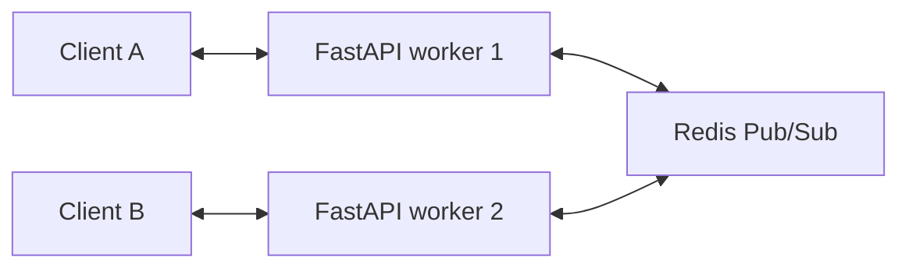

# Алго-дуэль — FastAPI WebSocket

Учебный проект: от простого WebSocket-сервера до многопользовательской игры для двух участников. Каждая лабораторная расширяет архитектуру предыдущей.

## Стек

Python 3.10+, FastAPI, Starlette, Uvicorn, asyncio, PyJWT, Jinja2, HTML/JavaScript, python-dotenv. На заключительном этапе — TestClient и Redis Pub/Sub.

## План работ

| № | Лабораторная | Основные темы | Статус |
|---|---|---|---|
| 1 | Эхо-сервер | Handshake, жизненный цикл | Выполнена |
| 2 | Общий чат | JSON, ConnectionManager, broadcast | Выполнена |
| 3 | Имена и онлайн | JWT, Cookie, Origin | Выполнена |
| 4 | Комнаты | RoomManager, изоляция сообщений | В работе |
| 5 | Лобби | Состояния и права игроков | Запланирована |
| 6 | Игра | asyncio, таймер, задачи | Запланирована |
| 7 | Надёжность | Heartbeat, reconnect | Запланирована |
| 8 | Тесты и масштабирование | TestClient, Redis Pub/Sub | Запланирована |



## ЛР №1. Эхо-сервер

Цель: изучить жизненный цикл WebSocket.

- [x] Создать WebSocket endpoint.
- [x] Изучить handshake и accept.
- [x] Реализовать приём, отправку сообщений и обработку отключения.



Результат: сервер возвращает клиенту полученное сообщение.

## ЛР №2. Общий чат

Цель: организовать обмен сообщениями между несколькими клиентами.

- [x] Реализовать ConnectionManager и хранение активных соединений.
- [x] Реализовать broadcast.
- [x] Определить JSON-протокол: chat, system, error.
- [x] Валидировать сообщения и удалять отключённые соединения.



Результат: подключённые клиенты получают сообщения общего чата.

## ЛР №3. Имена и онлайн — аутентификация

Цель: связать соединения с идентификаторами пользователей.

- [x] Реализовать HTTP-аутентификацию через форму.
- [x] Генерировать и проверять JWT (HS256, 30 минут).
- [x] Хранить JWT в HttpOnly cookie.
- [x] Защитить GET / и WebSocket handshake.
- [x] Проверять Origin для защиты от CSWSH.
- [x] Поддержать несколько соединений пользователя и персональную рассылку.



ConnectionManager хранит `dict[int, set[WebSocket]]`. Вкладки одного профиля используют общую cookie, но отдельные соединения. Для тестирования двух пользователей нужны разные профили или обычное окно и инкогнито.

Вместо предусмотренных первоначальным планом моделей Pydantic используются Form и ручная проверка JSON. Пользователи хранятся в памяти; refresh-токены и отзыв открытых соединений не реализованы.

## ЛР №4. Комнаты

Цель: изолировать сообщения между группами игроков.

- [ ] Спроектировать модель Room.
- [ ] Реализовать RoomManager: создание, вход, выход, удаление.
- [ ] Ограничить вместимость двумя игроками и членство одной комнатой.
- [ ] Реализовать room broadcast через send_personal.
- [ ] Определить команды комнат и обработать конкурентный доступ.
- [ ] Адаптировать интерфейс и проверить изоляцию.



Планируемая архитектура: ConnectionManager отвечает за доставку сообщений, RoomManager — за членство и состояние комнат. Предлагается хранить идентификаторы пользователей, а не сокеты. Состояние находится в памяти одного процесса.

## ЛР №5. Лобби

Цель: подготовить игроков к запуску дуэли.

- [ ] Определить состояния лобби.
- [ ] Реализовать готовность игроков и проверку прав на команды.
- [ ] Синхронизировать состояние между участниками.



## ЛР №6. Игра

Цель: реализовать серверный игровой цикл для двух участников.

- [ ] Спроектировать состояние матча.
- [ ] Реализовать таймер и асинхронные задачи.
- [ ] Обрабатывать игровые команды и завершение матча.
- [ ] Корректно отменять фоновые задачи.



## ЛР №7. Надёжность

Цель: обрабатывать потерю соединения и повторное подключение.

- [ ] Изучить Ping/Pong и прикладной heartbeat.
- [ ] Реализовать обнаружение недоступного клиента.
- [ ] Реализовать reconnect и восстановление состояния.
- [ ] Определить правила ожидания отключённого игрока.



## ЛР №8. Тесты и масштабирование

Цель: проверить приложение и изучить работу нескольких экземпляров backend.

- [ ] Автоматизировать HTTP и WebSocket тесты через TestClient.
- [ ] Проверить авторизацию, изоляцию комнат и отключения.
- [ ] Изучить межпроцессную рассылку через Redis Pub/Sub.
- [ ] Определить стратегию общего состояния комнат и матчей.



Redis Pub/Sub передаёт события, но сам по себе не обеспечивает хранение и согласованность игрового состояния. Схемы ЛР 4–8 предварительные и будут уточняться по мере реализации.

## Текущая структура проекта

```text
.
├── main.py
├── auth.py
├── users.py
├── manager.py
├── templates/
│   ├── index.html
│   └── login.html
└── README.md
```

## Локальный запуск

Создать и активировать виртуальное окружение, затем установить зависимости:

```bash
pip install fastapi "uvicorn[standard]" jinja2 PyJWT python-dotenv python-multipart
```

Создать локальный `.env`:

```dotenv
SECRET_KEY=replace_with_random_secret
ALGORITHM=HS256
ALLOWED_ORIGINS=http://localhost:8000,http://127.0.0.1:8000
```

Сгенерировать случайный секрет можно командой `python -c "import secrets; print(secrets.token_hex(32))"`.

```bash
uvicorn main:duel_app --reload
```

Открыть `http://localhost:8000`. Учебные пользователи `player1` и `player2` определены в `users.py`.

## Ограничения и безопасность

- Не добавлять реальные секреты, `.env` и виртуальное окружение в Git.
- В production использовать HTTPS/WSS, Secure cookies и хеширование паролей.
- JWT проверяется при handshake; истечение срока токена не закрывает существующее соединение автоматически.
- Состояние в памяти теряется при перезапуске процесса.
- Проект учебный, не предназначен для production без дополнительных доработок.
